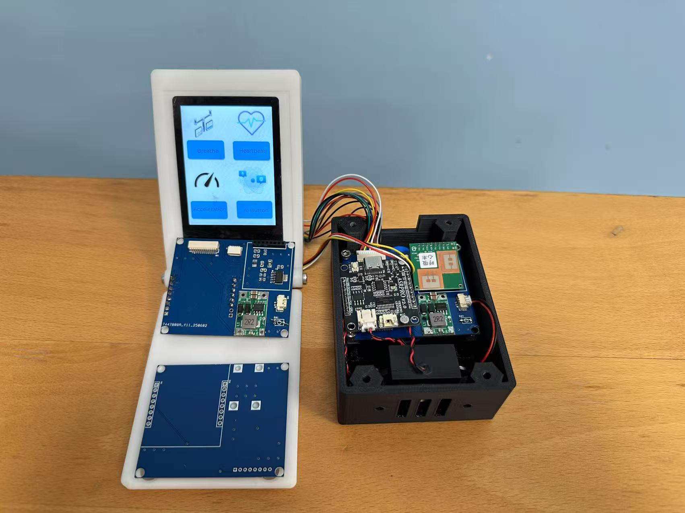
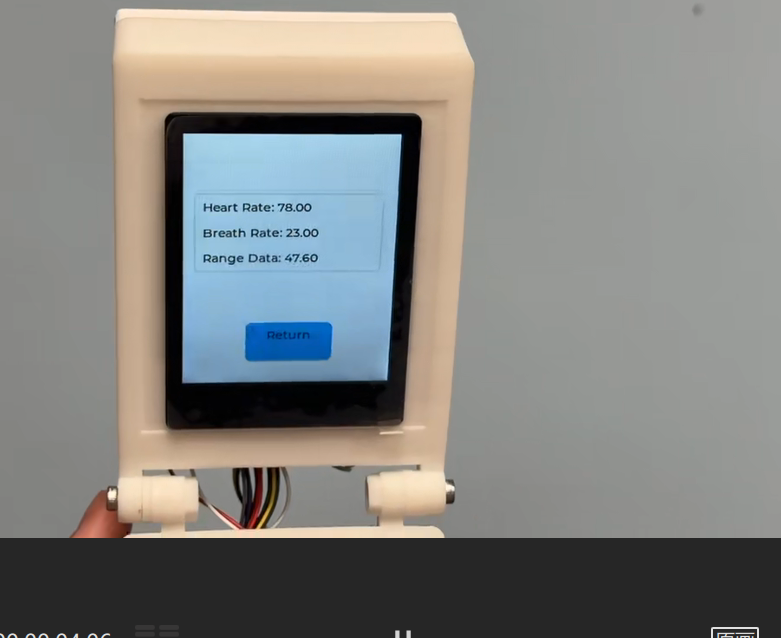
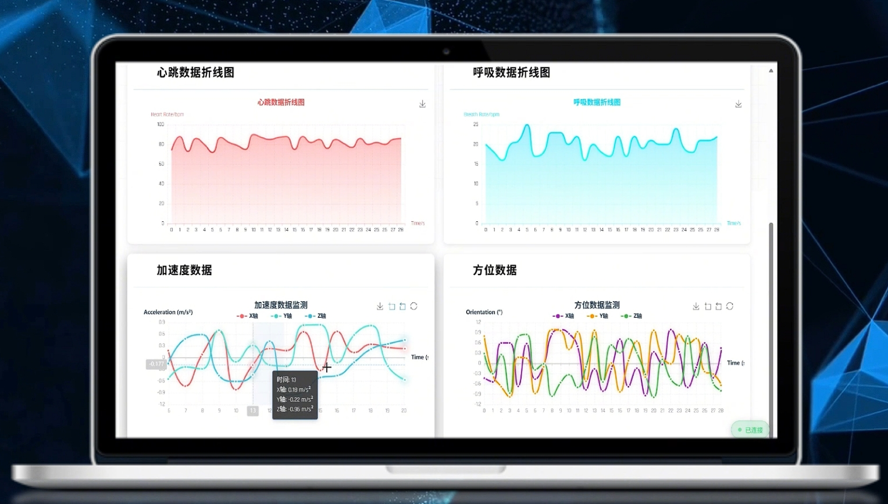
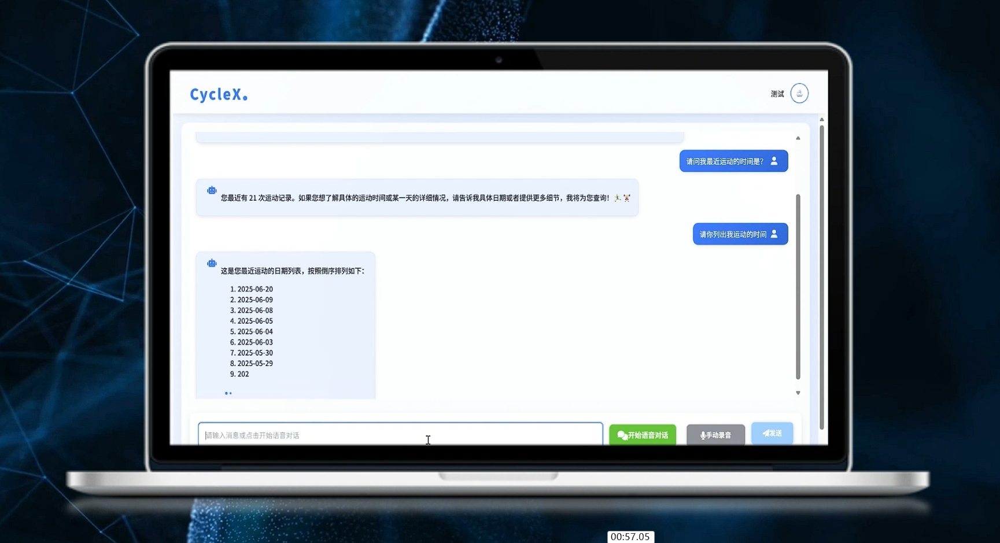
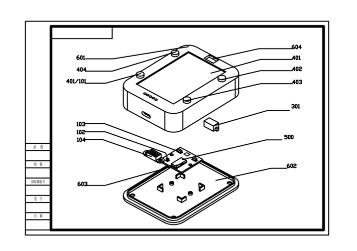
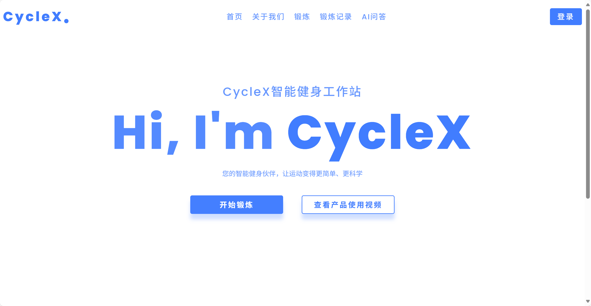
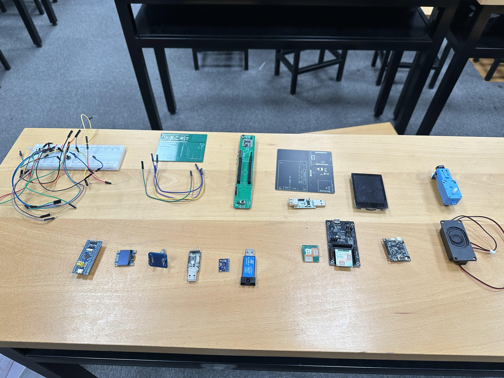

# CycleX 智能码表 — 基于毫米波雷达的非接触式生理监测健身码表

基于 **ESP32-S3 + 60GHz 毫米波雷达（LD6002）** 的多功能智能健身码表，可无接触实时监测**心率与呼吸率**，同时集成 IMU 姿态感知与踏频计数，通过 MQTT 上传数据至 Web 端大屏，并支持语音播报。本项目是 "FitnessX 多模态智能健身工作站" 的核心感知终端。



## 核心特性

- **非接触式生理监测**：60GHz 毫米波雷达（LD6002）实时提取心率、呼吸率、相位信息，无需佩戴胸带/手环
- **多传感器融合**：QMI8658 六轴 IMU（加速度/陀螺仪）+ PCNT 脉冲计数（踏频/速度）
- **本地彩屏 UI**：LVGL 图形界面，心率/呼吸/速度多页面显示，触摸交互（CST328 电容触摸）
- **物联网互联**：MQTT 协议（EMQX）上传 JSON 数据，Web 管理端实时展示
- **语音播报**：UART 外接语音模块，播报心率/呼吸率
- **配套 AI 助手**：Web 端接入大模型，支持自然语言查询运动记录与语音对话

| 屏幕界面 | Web 端 | AI 助手 |
|---|---|---|
|  |  |  |

## 硬件

| 模块 | 器件 | 说明 |
|---|---|---|
| 主控 | ESP32-S3 | 8MB Flash，Wi-Fi STA |
| 生理雷达 | LD6002 | 60GHz 毫米波，UART 输出心率/呼吸率 |
| IMU | QMI8658 | I2C，加速度 + 陀螺仪 |
| 踏频 | 霍尔传感器 + PCNT | 脉冲计数测速 |
| 显示 | 2.1" LCD（SPI） | LVGL 渲染 |
| 触摸 | CST328 | I2C 电容触摸 |
| 语音 | 语音模块 | UART2，自定义协议帧 |

**PCB 工程**：[hardware/PCB/cyclex.epro](hardware/PCB/cyclex.epro) — 立创EDA专业版工程，内含原理图、PCB 与器件清单（BOM），用立创EDA客户端打开即可查看/导出 BOM。

**结构设计**（3D 打印外壳）：
- [hardware/structure/STEP/](hardware/structure/STEP/) — 通用 STEP 格式（前壳/后壳/按钮/阻尼片/卡扣等，可直接 3D 打印）
- [hardware/structure/SolidWorks/](hardware/structure/SolidWorks/) — SolidWorks 源文件（第六版）



## 实物图

| 整机 | 内部元器件 |
|---|---|
|  |  |

更多实物照片见 [docs/photos/](docs/photos/)。

## 软件架构

```
├── main/
│   ├── main.c               # 入口：初始化各模块并创建任务
│   ├── setup/               # 外设初始化（GPIO/SPI/I2C/UART/NVS/WiFi）
│   ├── device/              # 设备驱动（LCD/触摸/QMI8658/PCNT）
│   ├── soft_drv/            # 软件驱动（LVGL Port、MQTT 客户端）
│   ├── app/                 # 应用层
│   │   ├── app_gether.c     # LD6002 雷达数据解析 + IMU/PCNT 采集
│   │   ├── app_sent.c       # JSON 组包 + MQTT 上报 + UART 语音帧
│   │   └── app_display.c    # LVGL 界面数据刷新
│   ├── ui/                  # SquareLine 生成的 LVGL 界面
│   └── lv_ui/               # 自定义 LVGL 页面逻辑
├── components/LD6002/       # LD6002 雷达协议解析库
├── hardware/                # PCB 工程 + 结构设计文件
└── docs/                    # 文档、系统图、实物照片
```

**任务模型**（FreeRTOS）：

| 任务 | 优先级 | 周期 | 职责 |
|---|---|---|---|
| app_gether_task | 10 | 事件驱动 | UART1 解析 LD6002 雷达帧，每 8 帧转发语音帧 |
| app_display_task | 9 | — | LVGL 界面刷新 |
| app_gether_data_task | 8 | 100ms | QMI8658 读取 + PCNT 测速，每分钟清零 |
| app_sent_data_task | 7 | 500ms | cJSON 组包 → MQTT 发布 + UART2 语音播报 |

**数据链路**：LD6002 →(UART1)→ ESP32-S3 →(MQTT/WiFi)→ EMQX → Web 大屏；ESP32-S3 →(UART2)→ 语音模块。

雷达协议解析细节（帧格式、IEEE754 浮点心率解析）见 [docs/images/debug/](docs/images/debug/)。

## 快速开始

1. **环境**：[ESP-IDF v5.2.3](https://docs.espressif.com/projects/esp-idf/zh_CN/v5.2.3/esp32s3/get-started/index.html)
2. **配置密钥**：复制密钥模板并填入你的 WiFi/MQTT 配置：

   ```powershell
   copy main\secrets.h.example main\secrets.h
   ```

3. **编译烧录**：

   ```powershell
   idf.py set-target esp32s3
   idf.py build
   idf.py flash monitor
   ```

> `main/secrets.h` 已被 .gitignore 排除，不会泄露你的 WiFi/MQTT 凭据。首次 clone 后必须先完成第 2 步，否则编译会报找不到头文件。

## 数据格式

MQTT 主题 `/topic/sensor_data`，每 500ms 上报一次：

```json
{
  "heart":    { "rate": 73.0, "phase": 0.12 },
  "breath":   { "rate": 16.0, "phase": 0.45 },
  "range_data": 0.85,
  "total_phase": 12.3,
  "acceleration": { "x": 0.01, "y": -0.02, "z": 0.98 },
  "gyroscope":   { "x": 0.5, "y": -1.2, "z": 0.3 },
  "pcnt_count": 120,
  "pcnt_speed": 45.6
}
```

## 相关资料

- [系统流程图](docs/images/system-flow.png) / [雷达数据流程](docs/images/radar-flow.jpg)
- [Web 管理端](docs/images/web-dashboard.png) / [小程序端](docs/images/mini-program.png) / [手机 App](docs/images/mobile-app.png)
- [EMQX 后台](docs/images/emqx-backend.png) / [心率数据解析](docs/images/heart-rate-backend.png)
- 三合一智能手柄（同系列作品）：[流程图](docs/images/handle-flow.png) / [示意图](docs/images/handle-diagram.png)

## License

MIT4.0
